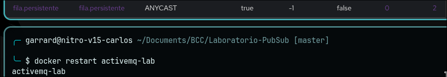

# Laboratório Pub/Sub com AMQP

Implementação de comunicação assíncrona em Java utilizando **AMQP 1.0**, **Apache ActiveMQ Artemis** e **Apache Qpid JMS**.

O projeto foi desenvolvido para a disciplina de Desenvolvimento Web do Bacharelado em Ciência da Computação — IFC Campus Rio do Sul.

## Visão geral

O laboratório demonstra três estratégias de mensageria:

| Experimento | Implementação | Comportamento |
| --- | --- | --- |
| Fila | `Produtor` + `Consumidor` | Distribui mensagens entre consumidores |
| Tópico | `PublicadorTopico` + `AssinanteTopico` | Faz fan-out para todos os assinantes ativos |
| Persistência | `ProdutorPersistente` + `ConsumidorPersistente` | Preserva mensagens não consumidas no broker |

### Resultado do fan-out

No experimento documentado, foram executados cinco assinantes simultaneamente. Cada assinante recebeu as cinco publicações, totalizando **25 recebimentos**.




## Tecnologias

- Java 17
- Apache Maven
- Jakarta Messaging (JMS)
- Apache Qpid JMS Client 2.11.0
- Apache ActiveMQ Artemis com endpoint AMQP em `localhost:61616`
- Docker para execução do broker

## Estrutura do projeto

```text
.
├── src/main/java/br/edu/ifc/pubsub/
│   ├── Produtor.java
│   ├── Consumidor.java
│   ├── PublicadorTopico.java
│   ├── AssinanteTopico.java
│   ├── ProdutorPersistente.java
│   └── ConsumidorPersistente.java
├── docs/
│   ├── Laboratorio_PubSub.pdf
│   └── prints/
├── relatorio/main.tex
├── pom.xml
└── classpath.txt
```

## Como executar

### 1. Inicie o broker

Suba o Apache ActiveMQ Artemis com AMQP disponível na porta `61616`. Configure no broker as credenciais esperadas pelo ambiente local e conecte-se a:

```text
amqp://localhost:61616
```

### 2. Compile o projeto

```bash
mvn clean compile
```

### 3. Execute os experimentos

Com o broker em execução, abra terminais separados para produtores e consumidores. O `classpath.txt` pode ser usado junto com as classes compiladas:

```bash
CP="$(cat classpath.txt):target/classes"

java -cp "$CP" br.edu.ifc.pubsub.Consumidor
java -cp "$CP" br.edu.ifc.pubsub.Produtor
```

Para o experimento de tópico, inicie um ou mais assinantes antes do publicador:

```bash
java -cp "$CP" br.edu.ifc.pubsub.AssinanteTopico
java -cp "$CP" br.edu.ifc.pubsub.PublicadorTopico
```

Para testar persistência:

```bash
java -cp "$CP" br.edu.ifc.pubsub.ProdutorPersistente
java -cp "$CP" br.edu.ifc.pubsub.ConsumidorPersistente
```

> O produtor de fila e o publicador de tópico enviam cinco mensagens com intervalo de 60 segundos entre elas.

## Evidências e relatório

O relatório completo, com metodologia, análise comparativa, resultados e capturas dos experimentos, está disponível em:

- [Relatório em PDF](docs/Laboratorio_PubSub.pdf)
- [Fonte LaTeX do relatório](relatorio/main.tex)
- [Registros e prints dos experimentos](docs/prints/)

### Modelo de comunicação

```text
Produtor ──► Broker AMQP ──► Consumidor(es)
                 │
                 └──────────► Tópico ──► Assinantes
```

## Autoria

Projeto acadêmico desenvolvido para fins de estudo de sistemas distribuídos, mensageria e arquitetura Publish/Subscribe.
